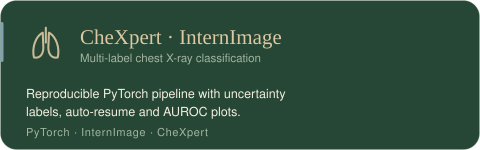
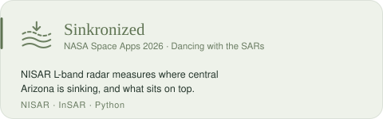
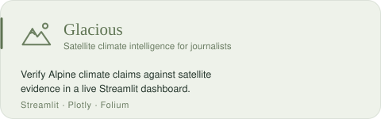
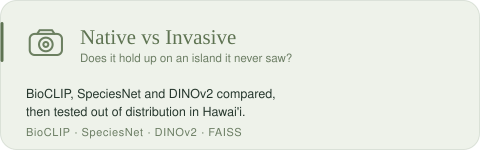
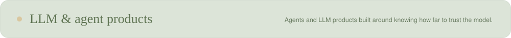
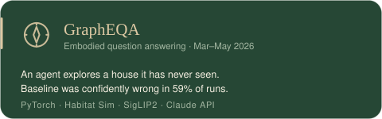

 

I work where perception meets decision: the moment a model stops describing the world and has to commit. M.S. in Robotics & Autonomous Systems (AI) from Arizona State University, now looking for roles in computer vision, machine learning and perception, with a soft spot for problems in health, conservation and sustainability.

My habit with any result is to try to break it: re-split the data, change one variable at a time, and treat a number that looks too good as a bug until it proves otherwise.

[Interactive dashboard](https://ray021207.github.io/ray021207/) &nbsp;·&nbsp; [Portfolio](https://ray021207.github.io) &nbsp;·&nbsp; [LinkedIn](https://www.linkedin.com/in/reshmapanibhate) &nbsp;·&nbsp; [Sinkronized, live](https://sinkronized.vercel.app) &nbsp;·&nbsp; [Glacious, live](https://glacious.streamlit.app/)

 

## Selected work

Open or close each field. Cards link to the code or case study.

<table>
<tr>
<td></td>
<td></td>
</tr>
<tr>
<td></td>
<td></td>
</tr>
</table>

<table>
<tr>
<td></td>
<td></td>
</tr>
<tr>
<td></td>
<td></td>
</tr>
</table>

<table>
<tr>
<td></td>
<td></td>
</tr>
<tr>
<td></td>
<td></td>
</tr>
</table>

## By the numbers

  

## Toolkit and timeline

  

  

