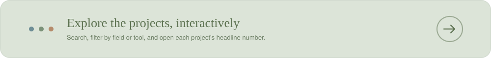

 

I work where perception meets decision: the moment a model stops describing the world and has to commit. M.S. in Robotics & Autonomous Systems (AI) from Arizona State University, now looking for roles in computer vision, machine learning and perception, with a soft spot for problems in health, conservation and sustainability.

My habit with any result is to try to break it: re-split the data, change one variable at a time, and treat a number that looks too good as a bug until it proves otherwise.

[Portfolio](https://ray021207.github.io) &nbsp;·&nbsp; [LinkedIn](https://www.linkedin.com/in/reshmapanibhate) &nbsp;·&nbsp; [Sinkronized, live](https://sinkronized.vercel.app) &nbsp;·&nbsp; [Glacious, live](https://glacious.streamlit.app/)

 

## Selected work

Jump straight to a field: &nbsp; <a href="https://ray021207.github.io/ray021207/#health">Health</a> &nbsp;·&nbsp; <a href="https://ray021207.github.io/ray021207/#env">Environment</a> &nbsp;·&nbsp; <a href="https://ray021207.github.io/ray021207/#agents">LLM &amp; agents</a>

<b>Health &amp; medical AI</b> &nbsp;·&nbsp; RecoveryIQ, CheXpert, athlete injury risk, medical imaging

 

- **[RecoveryIQ](https://github.com/ray021207/GlobeHack_Hydrawav3_RecoveryIQ)** · GlobeHacks 2026. Recovery platform for patients and practitioners, with live pose detection and AI clinical summaries. `Next.js` `TypeScript`
- **[CheXpert · InternImage](https://github.com/ray021207/CSE507_CheXpert_InternImage)** · Multi-label chest X-ray classification on 174k radiographs, about 0.80 AUROC under a patient-level split. `PyTorch` `InternImage`
- **[Athlete injury risk](https://github.com/ray021207/Comparative-Study-of-Approaches-for-Injury-Risk-Prediction-in-Athletes)** · Five models on wearable data; the one that scored 100% turned out to be a leak. `1D CNN` `Random Forest`
- **[Medical image processing](https://github.com/ray021207/Medical_Image_processing)** · Nine imaging exercises: U-Net lung segmentation, autoencoder anomaly detection, ResNet clustering. `U-Net` `ResNet`

<b>Environment &amp; sustainability</b> &nbsp;·&nbsp; Sinkronized, Glacious, WasteWise, native vs invasive species

 

- **[Sinkronized](https://github.com/ray021207/NASA-Hackathon)** · NASA Space Apps 2026. NISAR radar maps where central Arizona is sinking; 0.98 to 0.99 correlation with ADWR in SE Arizona. `NISAR` `InSAR` `Python`
- **[Glacious](https://github.com/ray021207/Glacious)** · Satellite climate intelligence for Alpine journalists, live as a Streamlit dashboard. `Streamlit` `Plotly` `Folium`
- **[WasteWise](https://github.com/ray021207/WasteWise)** · Snap an item and get Claude's disposal rules for your own city. Visual AI Hackathon @ ASU. `Claude` `FiftyOne`
- **[Native vs invasive species](https://github.com/ray021207/Comparitive-Study-for-Native-Invasive-species)** · BioCLIP, SpeciesNet and DINOv2 on camera traps, tested on an island none had seen: 97.34% with a fine-tuned SpeciesNet head. `BioCLIP` `DINOv2` `FAISS`

<b>LLM &amp; agent products</b> &nbsp;·&nbsp; kin&amp;d, Clarity, GraphEQA, LLM agent evaluation

 

- **[kin&amp;d](https://github.com/ray021207/HacksForHumanity)** · Hacks for Humanity. A parent describes a moment and gets 3 to 5 conversation starters. No chat, by design. `Next.js` `Claude API`
- **[Clarity](https://github.com/ray021207/Clarity)** · Trust layer that scores every LLM call from 0 to 100 using a multi-agent check. `LangGraph` `FastAPI`
- **[GraphEQA](https://ray021207.github.io/projects/graph-eqa.html)** · An agent explores a house it has never seen; the baseline was confidently wrong in 59% of runs. `Habitat Sim` `SigLIP2`
- **[LLM agent evaluation](https://ray021207.github.io/projects/webarena-deontic.html)** · Must / may / must-not rules added to WebArena to measure where GPT-4o breaks them. `WebArena` `GPT-4o`

## By the numbers

  

## Toolkit and timeline

  

  

